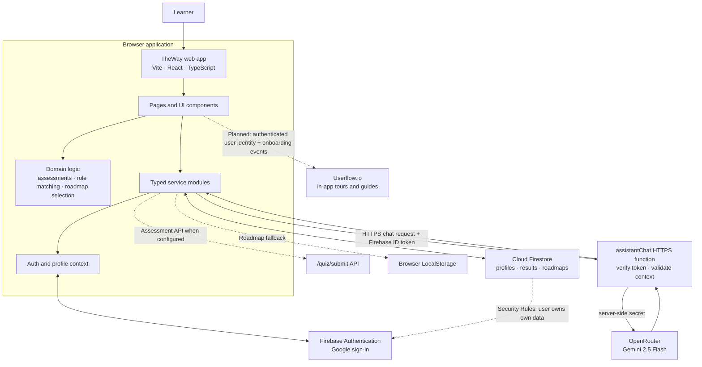
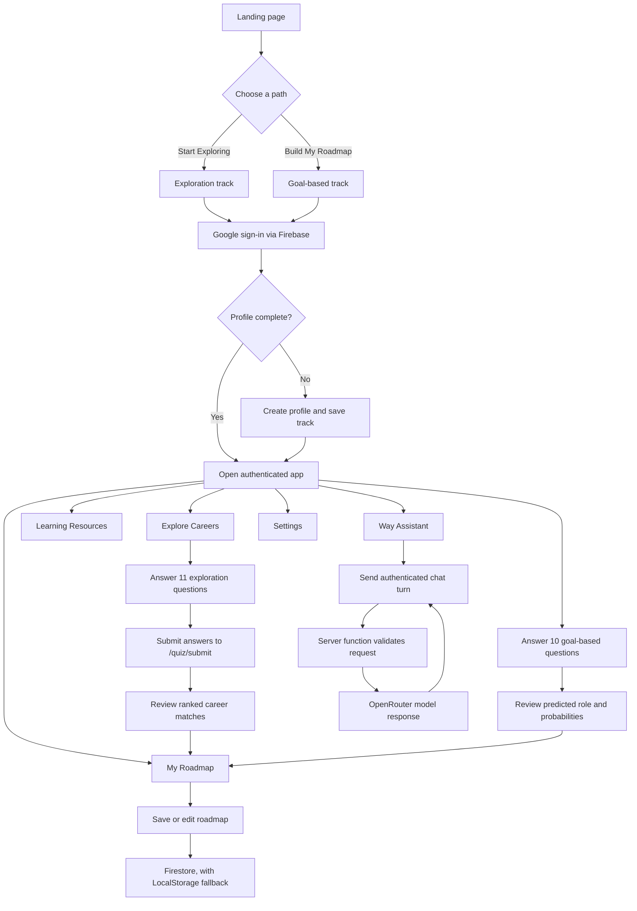
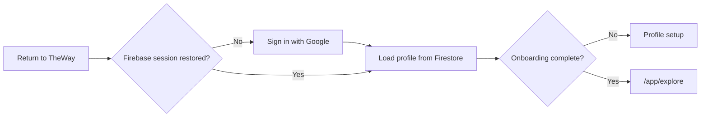

# TheWay System Design and Workflow

This page summarizes the current application architecture and the main learner journey. The Mermaid diagrams can be viewed in VS Code with a Mermaid preview extension, or copied into a Notion code block set to Mermaid.

## System design

### Main boundaries

- React pages render the experience and call typed services.
- Assessment and roadmap logic stays behind domain/service boundaries rather than being mixed into UI components.
- Firebase Authentication provides Google sign-in. Firestore stores the user's profile and learning data, protected by ownership rules.
- Assistant requests pass through a server function. The model provider key stays server-side and is never put in Vite client environment variables.
- Assessment submission calls `/quiz/submit`; roadmap data can use Firestore with a LocalStorage fallback.
- Userflow.io is shown as a planned integration for guided onboarding. It requires a Userflow environment token and should identify users only after Firebase authentication.

## Learner workflow

## Return-user workflow

## Notes for keeping the diagram current

This is a view of the implemented flow, including the assessment API integration and server-side assistant function. Update this page alongside `docs/specs/system-architecture.md` or `docs/specs/user-flows.md` when those contracts change.
